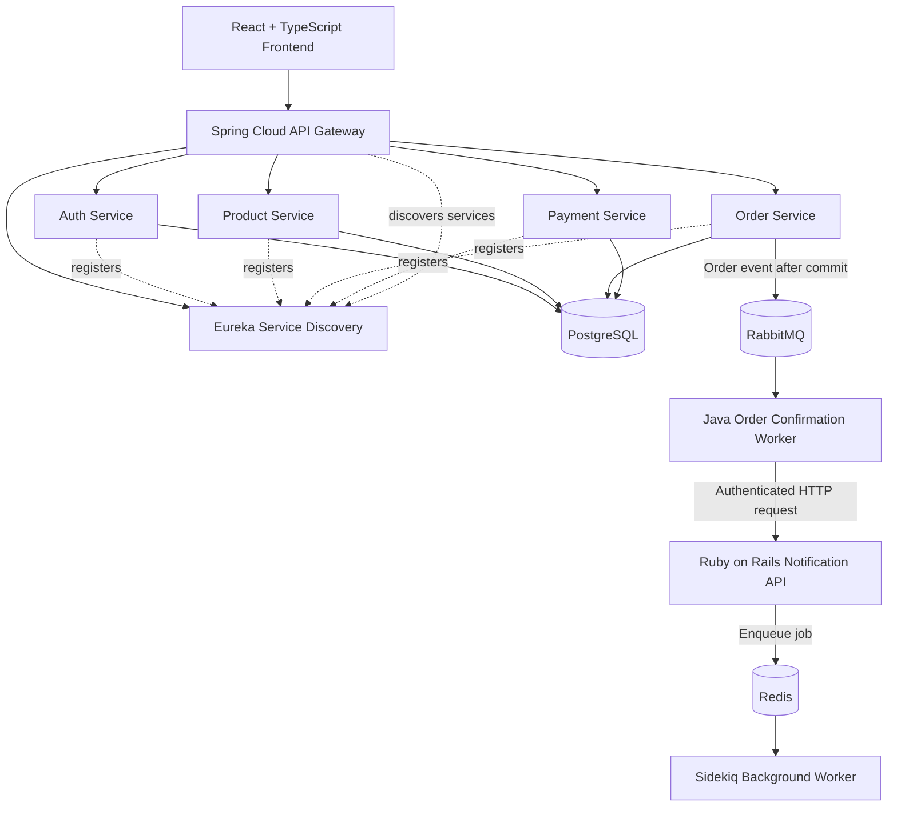

# ShopSphere — Full-Stack E-Commerce Platform

ShopSphere is a full-stack e-commerce application built around a **Java/Spring Boot microservices backend** and a **React + TypeScript frontend**. It brings together product discovery, cart and checkout workflows, demo payments, role-based administration, and asynchronous order-confirmation processing.

The project is also an engineering exercise in distributed systems: service discovery, API gateway routing, service-owned database schemas, event-driven messaging with RabbitMQ, and a separate Ruby on Rails + Sidekiq notification service backed by Redis.

> **Project scope:** Payment processing is a demo/simulation. The notification pipeline currently enqueues and processes/logs order-confirmation jobs; it does not deliver real email or SMS.

---

## Contents

- [Features](#features)
- [Architecture](#architecture)
- [Order-confirmation event flow](#order-confirmation-event-flow)
- [Services and ports](#services-and-ports)
- [Technology stack](#technology-stack)
- [Repository structure](#repository-structure)
- [Data and database design](#data-and-database-design)
- [Security](#security)
- [API overview](#api-overview)
- [Run locally with Docker Compose](#run-locally-with-docker-compose)
- [Run the frontend separately](#run-the-frontend-separately)
- [Environment configuration](#environment-configuration)
- [CI/CD](#cicd)
- [Accessibility](#accessibility)
- [Documentation](#documentation)
- [Current limitations and future improvements](#current-limitations-and-future-improvements)

---

## Features

### Customer experience

- User registration and login with JWT authentication.
- Product catalogue with product details, search, filtering, and sorting.
- Shopping cart: view, add, update, and remove items.
- Checkout and order creation.
- Demo payment processing and payment status tracking.
- Order history, order details, and order lifecycle/status information.
- Customer profile and address management.
- Frontend loading, empty, and error states for key API interactions.

### Administration

- Admin dashboard and analytics views.
- Product and category management.
- Inventory/stock management.
- Order status management.
- Role-aware access to administrative functionality.
- Customer and admin experiences protected by backend authorization.

### Platform and engineering

- Independently structured Spring Boot services.
- Eureka service registration and discovery.
- Spring Cloud API Gateway for routing and centralized cross-origin configuration.
- PostgreSQL persistence with Flyway database migrations.
- Service-to-service REST communication, including OpenFeign integrations.
- RabbitMQ-based asynchronous order-confirmation events.
- Ruby on Rails notification API with Sidekiq workers and Redis.
- Dockerfiles and Docker Compose orchestration for local development.
- GitHub Actions workflows for backend and frontend validation.
- Frontend accessibility improvements for keyboard use, navigation, focus, reduced motion, and high-contrast settings.

---

## Architecture

ShopSphere uses a microservices architecture. The browser communicates with the API Gateway; the gateway routes requests to backend services registered with Eureka. The Java services persist their domain data in PostgreSQL. The order-confirmation workflow is asynchronous and uses RabbitMQ to hand events to a Java consumer, which forwards them to the Rails notification API. Rails enqueues background work in Sidekiq, with Redis as its queue backend.



### Architectural responsibilities

| Component | Responsibility |
|---|---|
| Frontend | Customer and admin user interfaces; calls backend through the gateway |
| API Gateway | Entry point for API traffic, routing, and CORS handling |
| Eureka Server | Service registration and discovery |
| Auth Service | User registration, login, JWT, roles, and profile operations |
| Product Service | Product catalogue, categories, search, and inventory |
| Order Service | Cart, checkout, order creation, order lifecycle, and RabbitMQ event publishing/consumption |
| Payment Service | Demo payment processing and payment status |
| RabbitMQ | Durable message broker for order-confirmation events |
| Java order worker | Consumes RabbitMQ messages and forwards events to Rails |
| Rails notification service | Authenticates internal event requests and enqueues notification jobs |
| Redis | Sidekiq background-job storage/queue backend |
| Sidekiq | Executes asynchronous Rails jobs |

### Design choices

- **API Gateway:** keeps the frontend independent of internal service addresses.
- **Eureka:** allows services to register and discover one another by service identity.
- **Service ownership:** domain logic is separated by service rather than placing all responsibilities in one backend.
- **Asynchronous processing:** checkout does not need to wait for background notification work to finish.
- **Technology boundary:** core commerce services use Java/Spring Boot; the notification API and job runner use Ruby on Rails and Sidekiq.

---

## Order-confirmation event flow

The order-confirmation pipeline combines RabbitMQ with Rails, Sidekiq, and Redis.

1. A customer completes checkout and the Order Service persists the order.
2. After the order transaction commits, the Order Service publishes an order-confirmation event to RabbitMQ.
3. The Java `OrderConfirmationWorker` consumes the message from the durable `shopsphere.order-confirmation` queue.
4. The Java worker sends the event to the Rails internal endpoint: `POST /internal/order-confirmations`.
5. Rails validates the shared bearer token and enqueues an `OrderConfirmationJob`.
6. Sidekiq retrieves and executes the job using Redis.
7. The current job records/logs the structured event. An email provider can be integrated later.

```text
Order Service
    |
    | publish after database commit
    v
RabbitMQ
    |
    v
Java OrderConfirmationWorker
    |
    | POST /internal/order-confirmations
    | Authorization: Bearer <shared-token>
    v
Rails Notification API
    |
    | enqueue OrderConfirmationJob
    v
Redis  <---->  Sidekiq Worker
                   |
                   v
             Process / log event
```

RabbitMQ is the messaging handoff from the Java order service. Redis is used by Sidekiq for Rails background jobs; it does not replace RabbitMQ.

**Important:** this is an asynchronous processing foundation, not a completed email-delivery integration. See [background order notifications](docs/background-order-notifications.md) and [Rails + Sidekiq notifications](docs/rails-sidekiq-notifications.md).

---

## Services and ports

| Service / component | Local port | Main responsibility |
|---|---:|---|
| Frontend (Vite) | 5173 | React application |
| API Gateway | 8080 | Backend API entry point |
| Auth Service | 8081 | Authentication and users |
| Product Service | 8082 | Products, categories, inventory |
| Order Service | 8083 | Cart, orders, RabbitMQ integration |
| Payment Service | 8084 | Demo payments |
| Eureka Server | 8761 | Service registry dashboard |
| Rails notification API | 3000 | Internal order-confirmation endpoint and health check |
| RabbitMQ AMQP | 5672 | Message broker connection |
| RabbitMQ Management UI | 15672 | Local broker management |
| Redis | 6379 | Sidekiq job backend |
| PostgreSQL | 5432 | Relational database |

The Rails health endpoint is available at `http://localhost:3000/health`. The RabbitMQ management interface is at `http://localhost:15672` (local Compose defaults: `guest` / `guest`).

---

## Technology stack

| Area | Technologies |
|---|---|
| Backend services | Java 21, Spring Boot 3.2.x, Spring Cloud 2023.x |
| Backend security | Spring Security, JWT, BCrypt, role-based authorization |
| Persistence | Spring Data JPA, Hibernate, PostgreSQL, Flyway |
| Service communication | REST, OpenFeign, Spring Cloud Gateway, Eureka |
| Messaging | RabbitMQ |
| Notification API | Ruby, Ruby on Rails |
| Background jobs | Sidekiq, Redis |
| Frontend | React 19, TypeScript, Vite, React Router |
| Styling and icons | Tailwind CSS, Lucide React |
| Testing/tooling | JUnit 5, Mockito, Spring Boot Test, Vitest (where configured), Oxlint |
| Build tools | Maven, npm |
| Containers | Docker, Docker Compose |
| CI | GitHub Actions |

---

## Repository structure

```text
ShopSphere/
├── .github/
│   └── workflows/
│       ├── backend-ci.yml
│       └── frontend-ci.yml
├── api-gateway/                 # Spring Cloud Gateway
├── auth-service/                # Authentication, JWT, user management
├── product-service/             # Catalogue, categories, inventory
├── order-service/               # Cart, orders, RabbitMQ integration
├── payment-service/             # Demo payment processing
├── service-discovery/            # Eureka server
├── notification-service/         # Rails API and Sidekiq jobs
├── frontend/                     # React + TypeScript + Vite UI
├── shopsphere/                   # Parent Maven project
├── docs/
│   ├── api.md
│   ├── architecture.md
│   ├── background-order-notifications.md
│   ├── database.md
│   ├── deployment.md
│   ├── microservices.md
│   ├── rails-sidekiq-notifications.md
│   └── security.md
├── ACCESSIBILITY.md
├── AGILE.md
├── DEPLOYMENT_GUIDE.md
├── RUNNING_INSTRUCTIONS.md
├── docker-compose.yml
├── .env.example
└── README.md
```

---

## Data and database design

PostgreSQL is the relational data store for the Java commerce services. Flyway manages versioned schema migrations. The intended domain ownership is separated by service:

| Domain/schema | Example data |
|---|---|
| Authentication | Users and account/profile data |
| Product | Products, categories, and inventory |
| Order | Carts, cart items, orders, and order items |
| Payment | Payment records and status |

Services should access their own domain data through their application layer; cross-service workflows use service APIs rather than directly coupling service code to another service's tables.

The local Docker Compose configuration creates a PostgreSQL 15 container with database `shopsphere`. Review each service's Flyway migration files and [database documentation](docs/database.md) for the current schema details.

---

## Security

- JWT-based stateless authentication.
- BCrypt password hashing.
- Backend role-based authorization for customer/admin operations.
- Authenticated internal Rails endpoint using a shared service bearer token.
- CORS configuration at the API Gateway.
- Environment-based configuration for secrets and service connections.
- Flyway-managed database schema changes.

**Local-development warning:** values in the Compose file and `.env.example` are development defaults only. Replace them with strong secrets before any shared or production deployment. Do not commit real `.env` files, JWT keys, Rails secret keys, or notification service tokens.

---

## API overview

The following are representative API routes exposed through the gateway. See [docs/api.md](docs/api.md) and the service OpenAPI/Swagger configuration for the detailed request/response contracts.

| Area | Method | Route | Purpose |
|---|---|---|---|
| Auth | POST | `/api/auth/register` | Register an account |
| Auth | POST | `/api/auth/login` | Authenticate and obtain a token |
| Auth | GET | `/api/auth/me` | Get current authenticated user |
| Auth | PUT | `/api/auth/profile` | Update profile |
| Products | GET | `/api/products` | Browse/search products |
| Products | GET | `/api/products/{id}` | Get product details |
| Products | POST/PUT | `/api/products` and `/api/products/{id}` | Create/update products (authorized) |
| Products | PATCH | `/api/products/{id}/inventory` | Update inventory |
| Orders | POST | `/api/orders` | Create an order |
| Orders | GET | `/api/orders` | List the current user's orders |
| Orders | GET | `/api/orders/{id}` | Get order details |
| Orders | PATCH | `/api/orders/{id}/cancel` | Cancel an eligible order |
| Orders | PATCH | `/api/orders/{id}/status` | Update order status (authorized) |
| Payments | POST | `/api/payments` | Create/process a demo payment |
| Payments | GET | `/api/payments/{id}` | Get payment details |

The internal Rails endpoint `POST /internal/order-confirmations` is for service-to-service use and requires the configured bearer token. It is not a public customer endpoint.

---

## Run locally with Docker Compose

### Prerequisites

- Git
- Docker Desktop (or Docker Engine) with Docker Compose
- Java 21 and Maven (for running/building Java services outside containers)
- Node.js and npm (for frontend development outside containers)
- Ruby/Bundler only if developing the Rails service outside Docker

### 1. Clone the repository

```bash
git clone https://github.com/manikantavarma2889/ShopSphere.git
cd ShopSphere
```

### 2. Configure local secrets

Create a root `.env` file based on `.env.example`. At minimum, set a private local value for:

```env
NOTIFICATION_SERVICE_TOKEN=replace-with-a-long-random-local-token
SECRET_KEY_BASE=replace-with-a-long-random-secret
```

Use the same `NOTIFICATION_SERVICE_TOKEN` for the Java order service and Rails notification service. Compose supplies a local fallback if the variable is omitted, but that fallback must not be used in production.

### 3. Build and start the containers

```bash
docker compose up --build -d
```

Check container status:

```bash
docker compose ps
```

Follow all logs:

```bash
docker compose logs -f
```

Follow a specific service:

```bash
docker compose logs -f order-service notification-service notification-worker rabbitmq redis
```

### 4. Open local endpoints

- Frontend (start separately): http://localhost:5173
- API Gateway: http://localhost:8080
- Eureka dashboard: http://localhost:8761
- Rails health: http://localhost:3000/health
- RabbitMQ management: http://localhost:15672

### 5. Stop the stack

```bash
docker compose down
```

To also remove the local PostgreSQL volume and its data:

```bash
docker compose down -v
```

Only use `-v` if you intentionally want to delete the persisted local database volume.

---

## Run the frontend separately

Open another terminal from the repository root:

```bash
cd frontend
npm install
npm run dev
```

Vite serves the frontend at http://localhost:5173.

Available scripts:

```bash
npm run dev       # Start the development server
npm run build     # TypeScript project build and Vite production build
npm run lint      # Run Oxlint
npm run preview   # Preview the production build
```

The frontend expects the backend API to be available through the configured gateway/proxy settings. Check the frontend configuration before changing API base URLs.

---

## Environment configuration

The root `.env.example` documents the main local configuration categories:

| Variable | Purpose |
|---|---|
| `DATABASE_URL` | JDBC connection string for PostgreSQL |
| `DATABASE_USERNAME` / `DATABASE_PASSWORD` | Database credentials |
| `JWT_SECRET` | Signing/validation key for JWTs |
| `JWT_EXPIRATION` | Token lifetime in milliseconds |
| `EUREKA_SERVER_URL` | Eureka registry URL |
| `NOTIFICATION_SERVICE_URL` | Rails notification API base URL |
| `NOTIFICATION_SERVICE_TOKEN` | Shared Java-to-Rails service token |
| `REDIS_URL` | Redis connection used by Sidekiq |
| `SECRET_KEY_BASE` | Rails secret key base |
| `FRONTEND_URL` | Frontend origin used by local configuration |
| `SERVER_PORT` | Application port where supported |

Docker Compose also supplies service-specific environment variables and internal Docker hostnames. When running inside Compose, services connect to one another by Compose service name (for example, `rabbitmq`, `redis`, and `notification-service`), not by `localhost`.

---

## CI/CD

GitHub Actions workflows are located in `.github/workflows/`:

- **Backend workflow:** Maven-based backend build and verification.
- **Frontend workflow:** frontend dependency installation and frontend validation/build steps.

These workflows provide automated checks for changes pushed to the repository. A merge or a documented workflow file is not, by itself, proof that every service has passed a full end-to-end Docker integration test. Check the Actions tab for the status of the latest run.

---

## Accessibility

The frontend includes accessibility-oriented implementation work:

- Semantic navigation and main landmarks.
- Skip-to-main-content link.
- Focus movement to main content after route changes.
- Current-page navigation state with `aria-current`.
- Accessible names for icon-only controls.
- Mobile menu state exposed through `aria-expanded` and `aria-controls`.
- Visible `:focus-visible` indicators.
- Form validation state through `aria-invalid`.
- Reduced-motion support.
- Forced-colors/high-contrast support.
- Touch-target sizing and responsive interaction improvements.

See [ACCESSIBILITY.md](ACCESSIBILITY.md) for implementation notes and manual verification scenarios. The documented scenarios should not be interpreted as evidence that every assistive-technology test has been performed.

---

## Documentation

| Document | Description |
|---|---|
| [Architecture](docs/architecture.md) | System architecture, components, and design |
| [Microservices](docs/microservices.md) | Service boundaries and communication |
| [API reference](docs/api.md) | API endpoint documentation |
| [Database](docs/database.md) | Database design and migrations |
| [Security](docs/security.md) | Authentication and security details |
| [Deployment](docs/deployment.md) | Deployment notes |
| [Background order notifications](docs/background-order-notifications.md) | RabbitMQ order event and Java worker |
| [Rails + Sidekiq notifications](docs/rails-sidekiq-notifications.md) | Rails API, Redis, and Sidekiq workflow |
| [Running instructions](RUNNING_INSTRUCTIONS.md) | Additional local run and deployment instructions |
| [Agile workflow](AGILE.md) | Issue, branch, PR, review, and sprint workflow |
| [Accessibility](ACCESSIBILITY.md) | Frontend accessibility engineering |

---

## Current limitations and future improvements

The project demonstrates the end-to-end architecture, but the following production-hardening work remains:

- Integrate an email/SMS provider and credentials if actual customer notifications are required.
- Add a transactional outbox so database commits and event publication can be coordinated reliably.
- Configure RabbitMQ publisher confirms, retry policies, and dead-letter handling.
- Add idempotency protection for repeated notification events and stronger delivery observability.
- Replace local Compose secrets with managed secrets, TLS, and token rotation for deployed environments.
- Add and run full end-to-end tests covering checkout through RabbitMQ, Rails, Redis, and Sidekiq.
- Add production monitoring, tracing, and alerting across service boundaries.

---


